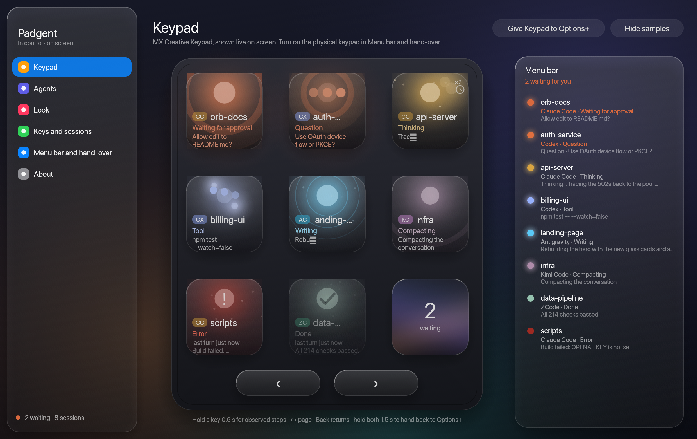
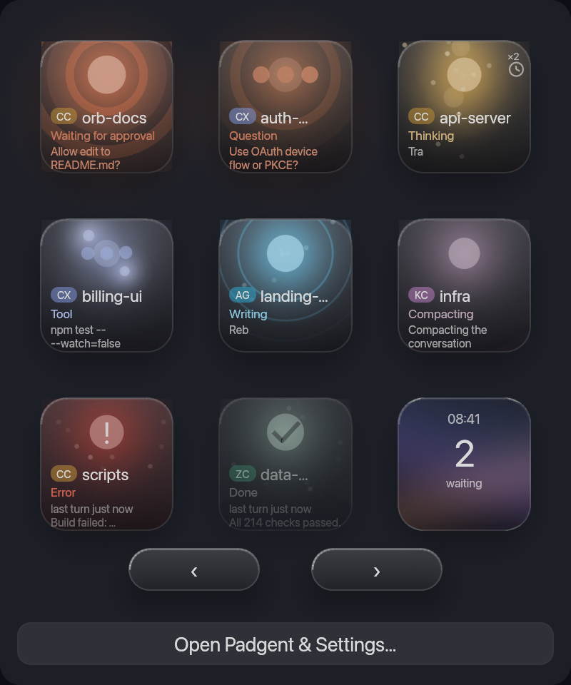
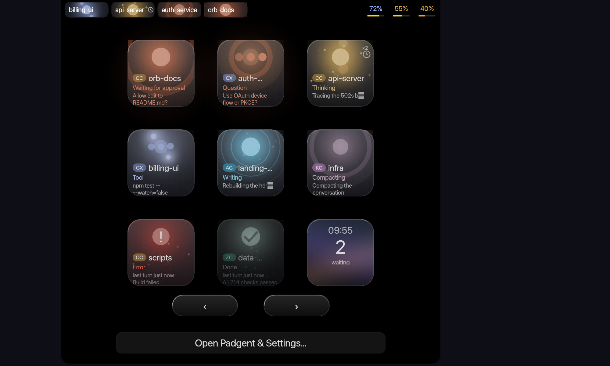

# Padgent

A light, native macOS menu-bar app that shows your AI coding agents and chats on a
**Logitech MX Creative Keypad** — one key per conversation, lit by what each one is doing —
and on screen as a Liquid Glass keypad. Written in Rust.

[Download Padgent](https://github.com/samhologram/padgent/releases/latest)



*Sample app with demonstration sessions.*



*Sample menu-bar keypad with demonstration sessions.*

- **Agents:** Claude Code, Codex, Antigravity, ZCode, Kimi Code, plus Claude desktop.
  Add any other agent by importing an `.orbagent.json` file, or follow a desktop
  app's conversations through macOS Accessibility (no logins in Padgent).
- **Keypad:** eight session keys and a hub key that counts what's waiting; previous/next page
  buttons; hold a session key 0.6 s to show observed steps, one per key; use the page buttons
  and Back to return; hold both page buttons 1.5 s to hand the keypad
  back to Logi Options+. Each key's light follows the session's state (thinking, tool, writing,
  waiting for approval or an answer, done, error, compacting). Sessions idle for more than
  30 minutes move to page 2 or later, except acknowledged tiles kept as dim placeholders.
- **Clear a page:** hold the bottom-right hub for 0.6 s to remove inactive keys from the
  current page without shifting the other keys. Working agents and those waiting for an
  answer or approval stay in place. Cleared conversations return when new activity is observed;
  changing pages during the hold cancels it.
- **Animated hub:** soft gold, lavender and blue gradients drift slowly behind the status
  count, with the same glass finish as the other keys. Reduced motion keeps the gradient still.
- **Tap to open:** opens the exact conversation in its app, or the terminal tab a Claude Code
  session runs in (Terminal, iTerm2). Opening an inactive conversation keeps its tile in
  place at 45% intensity. New sessions use free slots, then replace dim tiles when needed;
  replaced conversations remain accessible on later pages. Activity restores full intensity.
- **Desktop activity:** follows the activity shown by desktop chats, including synchronized
  replies started elsewhere. Recognized assistant questions show a Question status.
- **Scheduled runs:** recognizes local Claude Code scheduled sessions and Codex automation runs
  from local app records, with a small clock marker on their tiles and in the notch.
- **Codex Cloud tasks:** follows the first page of up to 20 tasks through the installed
  Codex CLI and opens each task at its exact web URL.
  Claude cloud-only scheduled runs and ChatGPT Dots unread messages are not tracked yet.
- **Menu bar:** left-click the icon to open the live 3×3 keypad; right-click for session
  previews, settings, hand-over and quit. The icon shows a waiting dot and count.
- **Display API and MCP:** apps and agents can reserve individual keys or the whole 3×3
  keypad, use Padgent's native animations, or compose custom gradients, text and shapes.
  Clear individual keys or the entire leased keypad, then release to restore native content.
  Both interfaces use the same display controller and renderers as the app.
  See the [display API guide](docs/display-api.md) for examples and MCP setup.
- **Notch island:** active agents appear to the left of the camera notch and observed remaining session and weekly quotas appear on the right, with a subtle response on hover.
  Click a session to open its conversation, a percentage to open usage, or the island background to unfold the interactive keypad.
  Completed or unread conversations stay bright until opened, then remain dimmed until work resumes.
  Choose Never, Always, When keypad disconnected, or Quotas always, agents when disconnected in Menu bar and hand-over settings. The last option keeps quotas visible and shows agents when the keypad is physically disconnected.
- **Settings:** colours, motion, key order, recent sessions, hand-over, launch at login, model
  roles for Claude Code (Haiku for the swarm, Sonnet for code, Opus for orchestration).

## Notch

Active conversations stay on the left; remaining session and weekly quotas stay on the right.
Click a conversation to open it, a percentage to view usage, or the black background to unfold the keypad from the notch.




## Build

Requires Rust (stable) on macOS 14 or later.

```sh
cargo build --release          # the program
./bundle.sh                    # builds target/Padgent.app
./dmg.sh                       # builds an Apple Silicon disk image in target/
cargo run -- --screenshot shot.png   # renders the window to a PNG and exits
cargo run -- --screenshot-menu-bar menu.png  # renders the menu-bar keypad and exits
cargo run -- --screenshot-island compact.png # renders the compact notch and exits
cargo run -- --screenshot-island-expanded expanded.png # renders the expanded notch and exits
```

On first use macOS asks you to allow Padgent in **Accessibility** (to follow desktop apps),
**Input Monitoring** (to read the keypad) and **Automation** (to select a terminal tab).

## Connecting agents

- **Claude Code:** Agents › Claude Code › *Install hooks* adds a small hook to
  `~/.claude/settings.json` that reports each session's state to Padgent on `127.0.0.1:47800`.
- **Anything else:** point its hooks or scripts at `POST http://127.0.0.1:47800/hook/<agent-id>`
  (hook JSON on stdin), or post a state directly:

  ```sh
  curl -X POST http://127.0.0.1:47800/event/my.agent \
    -d '{"session":"demo","state":"thinking","title":"My task","text":"Working on it"}'
  ```

States: `starting`, `idle`, `thinking`, `tool`, `streaming`, `waitingPermission`,
`waitingQuestion`, `done`, `error`, `compacting`, `offline`.

For direct display control, use `http://127.0.0.1:47800/v1/display` or connect an MCP
client to `http://127.0.0.1:47800/mcp` with Streamable HTTP. A display lease returns the
keys to their current native content when released or expired; it does not stop agent tracking.

## Agent files

```json
{
  "format": "agentpad.agent", "version": 1,
  "id": "com.example.myagent", "name": "My Agent", "badge": "MA",
  "hue": 200, "style": "orb",
  "app_name": "My Agent", "watch_app": "com.example.myagent.desktop",
  "state_colours": { "working": "#4aa3ff" }
}
```

## Notes

`MECHANICS.md` documents the app’s behaviour (timings, colours, keypad
protocol). The physical keypad driver is experimental.

Padgent is not affiliated with Logitech, Anthropic or OpenAI. Logitech, MX and
Options+ are trademarks of Logitech; Claude is a trademark of Anthropic; Codex and ChatGPT are
trademarks of OpenAI.

## Architecture

The [tracking architecture](docs/tracking-architecture.md) describes how app observations,
session identity, source arbitration and tile placement fit together.

## License

MIT — see `LICENSE`.

### Quotas

Press the previous page button from the first session page to see quota observations on the keypad, the main window and the menu-bar keypad. The page buttons cycle through quotas and session pages. Quota keys are informational and do not open or clear sessions.

Codex readings come from recent local session logs and reflect the most recent reported rate-limit event, not a live account query. A passed reset time or an old observation does not imply the allowance has refreshed. Only quota windows that have actually been observed are shown; a platform or quota type with no observation has no tile. Claude Desktop quota readings come from a visible usage summary when Accessibility access is enabled. Readings expire after 15 minutes or their reported reset time, whichever comes first; expired readings show Unknown until refreshed.
