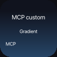

# Display API and MCP

Padgent accepts agent observations through its existing `/hook` and `/event` routes.
The display API adds direct control of the nine LCD keys. It is available on the same
local server at `http://127.0.0.1:47800` while Padgent is running.

HTTP and MCP call the same typed commands in `Core`. Controlled keys pass through the
normal keypad face projection and app, menu-bar, expanded-notch and physical-key renderers.
Native tracking continues underneath the controlled display.

## Key ownership

Indices run left to right, top to bottom:

```text
0 1 2
3 4 5
6 7 8
```

Claim a subset for individual keys, or `[0,1,2,3,4,5,6,7,8]` for the full keypad.
Different clients can own disjoint keys at the same time; overlapping claims fail with
HTTP 409. Claims initially show blank custom scenes.

A claim returns a capability `token`. Keep it for updates, renewal, events and release.
The default lifetime is 60 seconds; valid lifetimes are 1–3600 seconds. Renew while
your content is useful. Expiry or release restores the current native content, including
activity that arrived during control. Claims and tokens are not saved across app restarts.

In the app's Keypad view, **Release external** releases all display clients immediately.
The two physical page buttons retain their normal navigation and hold-both hand-over behavior.
Display control does not take the hardware away from Options+ automatically.

## HTTP

| Method and path | Body | Result |
| --- | --- | --- |
| `GET /v1/display` | — | Active owners, key indices and expiry times; no tokens |
| `POST /v1/display/claim` | `owner`, `keys`, optional `ttl_seconds` | Token and expiry |
| `POST /v1/display/set` | `token`, `keys` mapping | Atomic scene update |
| `POST /v1/display/clear` | `token`, optional `keys` array | Blanks selected keys, or all keys in the lease |
| `POST /v1/display/renew` | `token`, optional `ttl_seconds` | New expiry |
| `POST /v1/display/release` | `token` | Restores the lease's keys |
| `POST /v1/display/events` | `token` | Drains queued key-press events |
| `GET /v1/display/keys/{index}/preview.png` | — | PNG from the LCD renderer |

POST bodies are JSON. Unknown fields and invalid scenes are rejected. A failed update
changes none of its keys. Invalid or expired tokens return 403; invalid input returns 400.
The server listens only on loopback and rejects browser Origin headers and non-local Host headers.

Claim two keys:

```sh
curl -sS http://127.0.0.1:47800/v1/display/claim \
  -H 'Content-Type: application/json' \
  -d '{"owner":"Build monitor","keys":[0,1],"ttl_seconds":60}'
```

Use the returned token in subsequent requests:

```json
{
  "token": "TOKEN_FROM_CLAIM",
  "keys": {
    "0": {
      "kind": "native",
      "title": "Build",
      "text": "Running checks",
      "activity": "thinking",
      "style": "dots",
      "color": "#b8a4ff"
    },
    "1": {
      "kind": "custom",
      "title": "Deploy",
      "text": "42% complete",
      "background": "#101827",
      "foreground": "#ffffff",
      "accent": "#9a7be8",
      "animation": "gradient",
      "period_seconds": 24,
      "layers": [
        {"kind":"rect","x":0.12,"y":0.78,"width":0.76,"height":0.05,"color":"#303747"},
        {"kind":"rect","x":0.12,"y":0.78,"width":0.32,"height":0.05,"color":"#c4b1ff"}
      ]
    }
  }
}
```

Send this body to `POST /v1/display/set`. Supplying `null` for a key blanks it while
retaining ownership. Release its lease to restore the app's content.

To blank one key explicitly, post `{"token":"TOKEN_FROM_CLAIM","keys":[0]}` to
`/v1/display/clear`. Omit `keys` to blank every key in that lease. A lease owning all
nine keys can therefore clear the whole keypad in one call. Clearing does not release
ownership or erase native conversations, and cannot affect another client's keys.

## Native patterns and custom composition

Examples rendered through the display API:




Native scenes use the app's session animations: `starting`, `idle`, `thinking`, `tool`,
`streaming`, `waitingPermission`, `waitingQuestion`, `done`, `error`, `compacting` or
`offline`. Choose `style: "orb"` or `"dots"` and a full RGB `color`, such as `#b8a4ff`.
The older `hue` field remains a fallback when `color` is omitted.
The existing status names stay the same. `title` and `text` hold your content. Optional
`badge`, `status_text` and `footer_text` overrides can customize or hide individual labels;
an empty string hides a label, while omitted status/footer overrides use their defaults.

Custom scenes combine a background/accent gradient, foreground text and ordered layers.
The client or agent translates its design instructions into this scene description;
Padgent does not execute scripts or interpret natural language as code.

| Field | Values |
| --- | --- |
| `kind` | `native` or `custom` |
| `color` | Native scene RGB color; preserves saturation and brightness |
| `title`, `text` | Up to 64 and 160 characters respectively |
| `background`, `foreground`, `accent` | Hex RGB colors, such as `#856be0` |
| `animation` | `none`, `pulse`, `drift` or `gradient` |
| `period_seconds` | 1–120 seconds; default 4 |
| `layers` | Up to 16 ordered layers |

Layer kinds are `rect`, `circle`, `ellipse`, `line` and `text`. Layer `x`, `y`, `width`,
`height` and `size` are normalized to the key's dimensions, from 0 to 1; `color` is hex RGB.
For text layers, `size` is the font size and `text` holds up to 100 characters. For a line,
`size` is its thickness and the endpoints are `(x,y)` and `(x+width,y+height)`.
Circles and ellipses fit the supplied rectangle; use equal width and height for a circle.
Layer coordinates start at the top-left. Content is clipped to its key.

Reduced motion and brightness follow Padgent's settings. Scene changes replace a key's
press identity: a press started before a replacement cannot trigger an action on the new
scene. Updating another key leaves the original press valid.

## Actions, press events and previews

A scene can also define a simple action:

```json
{
  "kind": "native",
  "activity": "idle",
  "title": "Documentation",
  "text": "Open the guide",
  "action": {"type":"open_url","url":"https://example.com"}
}
```

Supported actions are `open_url` with an HTTP(S) `url`, and `open_app` with a macOS
`bundle_id`, such as `com.apple.Safari`. The action runs only when the user presses and
releases that controlled key. Publishing or previewing a scene does not run it. A replaced
or expired key cannot execute an old action.

Controlled keys send events to their owner instead of opening native conversations:

```json
{"events":[{"key":0,"type":"press","at":1700000000.0}]}
```

Poll `POST /v1/display/events` with the token. Polling drains the queue. Each lease keeps
at most 128 events; new events replace the oldest when full. The client decides how to
respond. A press event remains available even when the scene has an action. Display
clients cannot supply shell commands or executable scripts.

The PNG preview uses the same renderer as the physical LCD. For a reproducible animation
sample, add `?time=2`; accepted times are finite seconds from 0 through 86400. Previews are
rendered frames, not photographs of the physical device.

## MCP setup

Connect a client using **Streamable HTTP** at:

```text
http://127.0.0.1:47800/mcp
```

The app's **API & MCP** tab includes a copyable setup prompt for your agent. You can
also use the [README setup instructions](../README.md#instructions-to-give-your-agent).

The embedded server supports MCP protocol **2025-11-25**, with JSON responses and no
server-to-client SSE stream. It does not implement the newer draft protocol. Clients
negotiate with `initialize` and send `MCP-Protocol-Version: 2025-11-25` afterward.
POST requests must accept both `application/json` and `text/event-stream`.

| MCP tool | HTTP equivalent |
| --- | --- |
| `display_state` | Read active leases |
| `display_claim` | Claim keys |
| `display_set` | Set scenes |
| `display_clear` | Blank selected keys or all keys in a lease |
| `display_renew` | Renew a lease |
| `display_release` | Release a lease |
| `display_events` | Drain press events |

Arguments are the same JSON objects as the HTTP bodies, without an `op` field.
For example, ask an agent: “Claim key 0 for one minute and show a native thinking
animation titled Build. Put a custom slow purple gradient and deploy progress on key 1.
Release both when finished.” The tools return the token the agent needs for later calls.

See the [MCP transport specification](https://modelcontextprotocol.io/specification/2025-11-25/basic/transports).

## Isolated development server

```sh
cargo run -- --serve-demo 47801
```

This serves sample sessions on another port without starting watchers, driving the keypad
or saving settings. Point clients at port 47801 when experimenting with the API.

With that server running, exercise HTTP and the official MCP Python client, including
rendered text, native/custom animations, per-key/full-grid control and lease recovery:

```sh
uv run --with 'mcp==2.3.0' scripts/display_smoke.py \
  --url http://127.0.0.1:47801 --output-dir /tmp/padgent-display-previews
```
