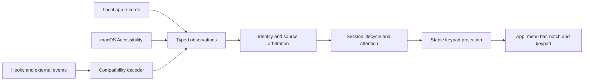

# Tracking architecture

Padgent combines several observations of a conversation into one tracked session. App
identity, execution state, attention and keypad position have different owners.

## Sources

| Integration | Evidence |
| --- | --- |
| Claude Code | Hook events, live process/session records, transcript steps, desktop observations |
| Claude desktop chats | Accessible conversation URL, messages and generation controls |
| ChatGPT desktop chats | Accessible windows and messages |
| Codex | Read-only thread/turn/item databases and read receipts |
| Codex Cloud tasks | Official `codex cloud list --json`, first page of up to 20 tasks |
| Scheduled runs | Explicit local Claude task/session links and Codex automation/thread links |

Reading a local database with `sqlite3` is an acquisition mechanism. It does not make
that database an official provider API. Native file formats and accessibility labels
belong inside their adapters.

## Boundaries

- `local.rs` and `watch.rs` acquire facts and emit `Observation`. They normalize provider
  timestamps, identifiers, activity and steps. They do not edit tracked sessions.
- `cloud.rs` reads the installed Codex CLI's cloud task inventory. It reuses CLI
  authentication, bounds command execution, deduplicates unchanged records and retains
  the exact validated task URL. This inventory is distinct from general web chat history.
- `observation.rs` defines the typed contract. Its compatibility decoder translates the
  existing hook and external-event JSON formats. Private wire keys stay at that boundary.
- `tracking.rs` owns source arbitration and visibility policy. Fresh desktop evidence
  protects Claude activity and response text from conflicting local snapshots. Older
  desktop observations are rejected. A blocked snapshot can be replayed after the live
  evidence expires.
- `model.rs` composes observations, resolves identity aliases, and applies lifecycle and
  attention transitions. Claude host and CLI identifiers can describe the same session;
  resolving them also preserves held-key and detail-view targets.
- `layout.rs` owns stable positions. Acknowledgement leaves a dim tile in place. New or
  resumed work fills free first-page slots, then replaces dim tiles if needed. Replaced
  tiles remain accessible on later pages without shifting bright neighbours.
- `integrations.rs` opens the resolved conversation or terminal target. Acquisition and
  navigation remain separate operations.

## Observation semantics

An update carries changed facts. A heartbeat refreshes source evidence without renewing
the session's activity age or attention. A discovery can create a missing session from
a native record; discovering an existing session does not overwrite its current state.
The acquisition time and the native record's activity time are separate timestamps.

Scheduled origin does not imply unread, active or finished. Ordinary inactive sessions
follow the configured recency window; scheduled background records remain discoverable
within the existing 12-hour retention window. Local acknowledgement and native read receipts are
separate from that origin marker.

Claude Code cloud routine runs (`session_…`) are distinct from local desktop runs
(`local_…`). Local metadata and local session SDKs do not establish coverage of those
cloud runs. A cloud connector must prove its inventory, authentication and trigger
provenance before it can replace desktop acquisition.

Changes to tracking should be tested as event sequences: conflicting sources, stale
observations, metadata-only updates, identity resolution, and acknowledgement followed
by resumed activity. Provider-specific labels and file fields should not add new JSON
branches to the typed reducer or position allocator.
